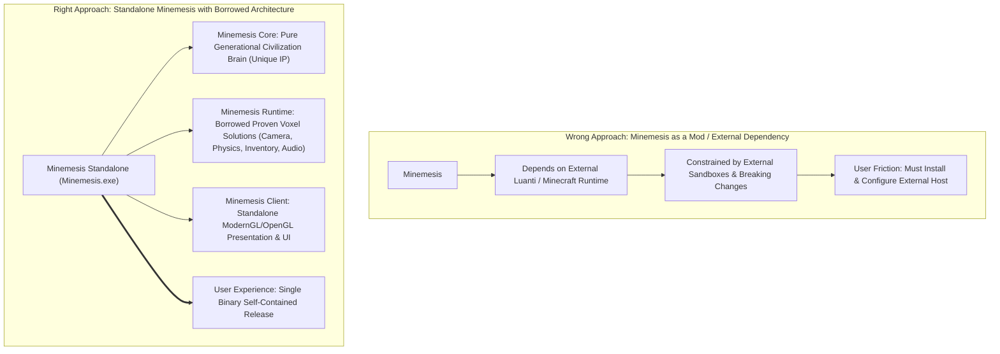
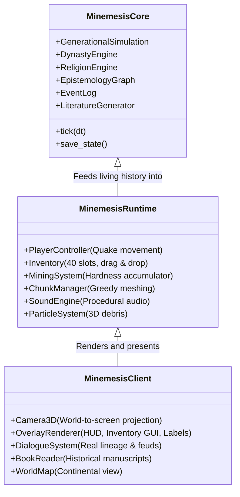

# MINEMESIS2: STANDALONE GAME ARCHITECTURE & TECHNOLOGY BLUEPRINT

> **Core Directive:** **MINEMESIS2 MUST SHIP AS AN INDEPENDENT STANDALONE GAME.**  
> - **The User Experience:** Download `Minemesis.exe` $\to$ Double click $\to$ Play. Nothing else required.  
> - **Zero External Runtimes:** No Minecraft dependency, no Luanti installation, no Minetest installation, no Godot installation.  
> - **The Guiding Principle:** *Minemesis owns the brain. We blatantly borrow, adapt, and integrate 15 years of proven voxel solutions (Luanti, Minecraft, Quake, Veloren) into our own self-contained executable rather than reinventing the wheel.*

---

## 1. The Strategic Pivot: Independent Game vs. Mod

There is a fundamental difference between two approaches:

### The Inviolable Architectural Separation

| Subsystem | Source of Truth | Design Strategy |
| :--- | :--- | :--- |
| **History & Time Engine** | **Minemesis Core (Unique IP)** | 200+ years of generational simulations, births, marriages, feuds, deaths. |
| **Beliefs & Memories** | **Minemesis Core (Unique IP)** | Subjective belief graph; NPC knowledge diffusion, gossip, trauma, and vendettas. |
| **Dynasties & Politics** | **Minemesis Core (Unique IP)** | True generational clans, chief successions, realm defensibility, diplomatic standings. |
| **Literature Generation** | **Minemesis Core (Unique IP)** | Historical biographies, poetry, chronicles transcribed by ancient scribes. |
| **Camera & Mouse Look** | **Borrowed (Quake / Luanti)** | Raw mouse input with exponential smoothing and dynamic view bobbing. |
| **Movement & Gravity** | **Borrowed (Quake / Luanti)** | Ground friction (9.0), wall-face tangent sliding, 1.1m auto-stepping, gravity fall. |
| **Mining & Placement** | **Borrowed (Minecraft / Luanti)** | Continuous mining hardness accumulator, progressive face cracks, particle burst, ghost preview. |
| **Inventory & Hotbar** | **Borrowed (Minecraft / Luanti)** | 9 hotbar, 27 storage, 4 equipment, left-click swap, right-click split, shift-click quick move. |
| **Audio & Game Feel** | **Borrowed / Synthesized** | Zero-dependency procedural WAV sound synthesis (break crunch, place thud, UI click). |
| **NPC Navigation** | **Borrowed (Veloren / Luanti)** | Whisker lookahead obstacle avoidance probes ($\pm 40^\circ$ at $1.2$m). |

---

## 2. Subsystems: What Was Borrowed vs. What Is Unique

### 2.1 The "Solved Problems" We Borrow
Nobody cares if your mouse look algorithm or hotbar slot drag logic is original. These problems have been solved across dozens of open-source projects:

1. **Movement Feel (Quake / Luanti)**:
   - Implemented `FRICTION = 9.0` ground deceleration and wishdir acceleration.
   - Implemented wall-face tangent sliding: hitting an obstacle on X zeroes only $v_x$, leaving $v_z$ intact so the player slides smoothly forward along walls instead of sticking dead.
   - Implemented landing shock absorption: negative camera dip on ground contact that decays smoothly.
   - Dynamic sprint FOV interpolation: camera smoothly expands by $+8.0^\circ$ while sprinting.

2. **Mining & Block Interaction (Minecraft / Luanti)**:
   - Instant block deletion felt like a debugging editor. We implemented a continuous hardness break timer (`hardness * 0.75`), 4-stage progressive crack lines, an embodied first-person arm swing arc, and 14-particle debris scattering.

3. **Inventory UX (Minecraft / Luanti)**:
   - 40-slot layout (4 equipment, 27 main grid, 9 active hotbar).
   - Left-click pick/drop/swap, Right-click split half / single-drop, Shift-click quick move between hotbar and main storage.
   - Coordinate hit-testing, glowing hover outlines, floating tooltip cards, and cursor stack following the mouse.

4. **Zero-Dependency Procedural Audio Engine (NEW)**:
   - Added `engine/core/audio.py` using Python's built-in `winsound` multimedia system.
   - Synthesizes 16-bit 22050Hz PCM audio completely in-memory:
     - `break`: crunchy, crumbly noise burst on block destruction.
     - `place`: solid, crisp wooden/stone thud on placement.
     - `click`: subtle high-frequency UI slot selection click.
     - `punch`: gentle air whoosh on fist swing.
   - Non-blocking threaded playback ensures 0ms frame lag.

5. **Developer Quality-of-Life Debug Modes (NEW)**:
   - **`[F8]` 3D Spectator Fly Mode**: 6-DOF look-direction flight, Space/Ctrl vertical lift, and $42\text{ m/s}$ fast travel sprint.
   - **`[F9]` Creative Build Mode**: Instant 1-click block mining (zero hardness delay) and infinite block placement.
   - **Overhead NPC Debug Labels**: Floating world-to-screen label cards displaying Name, Clan, Profession, and Current AI Task above every citizen within 35 meters.

---

## 3. Technology Evaluation for Future Standalone Scaling

While Minemesis currently runs as a standalone Python/ModernGL executable ([`releases/Minemesis.exe`](file:///d:/minemesis/releases/Minemesis.exe)), we evaluated the architectural patterns of the top five open-source engines for how Minemesis can scale without losing single-binary independence:

| Engine | Core Pattern to Borrow | Feasibility for Self-Contained `.exe` | Recommendation |
| :--- | :--- | :---: | :--- |
| **Luanti (Minetest)** | Formspec UI patterns, client-server event ticks, SQLite world chunk schema (`map.sqlite`) | **High** (Study C++ architecture; port concepts directly into Python/C) | **Primary Reference Implementation** |
| **Veloren** | Procedural settlement layout, whisker NPC navigation, multi-threaded ECS chunk mesher | **High** (Borrow algorithms) | **Secondary Reference** |
| **Godot 4 + `godot_voxel`** | Forward+ Vulkan rendering, node-based UI containers, GDExtension native embedding | **High** (Can compile into a single self-contained binary) | **Candidate for Minemesis 2.0 Client** |
| **Terasology** | Gestalt modular block systems | **Low** (JVM dependency too heavy for lightweight standalone distribution) | **Reference Only** |
| **Vintage Story** | Micro-block chiseled aesthetics, societal wall defense mechanics | **N/A** (Proprietary commercial engine; cannot redistribute) | **Design Inspiration Only** |

---

## 4. The Minemesis2 Layered Architecture

To prevent future custom engine traps, the codebase is strictly separated into three isolated layers:

---

## 5. Summary of Completed Deliverables

1. **Standalone Binary Verified**:
   - [`releases/Minemesis.exe`](file:///d:/minemesis/releases/Minemesis.exe) and [`releases/Minemesis-portable.zip`](file:///d:/minemesis/releases/Minemesis-portable.zip) (51.1 MB).
   - Single-file executable: zero external dependencies, double-click to play.
2. **Procedural Sound Engine**:
   - [`engine/core/audio.py`](file:///d:/minemesis/engine/core/audio.py) wired into block breaking, placement, and UI inventory interactions.
3. **Developer Debug Controls**:
   - `[F8]` 3D Spectator Fly Mode & Fast Travel ($42\text{ m/s}$).
   - `[F9]` Creative Build Mode (Infinite blocks & instant mining).
   - Overhead 3D NPC Debug Labels (Name, Family, Job, Task).
4. **All 11 Pillars Verified**:
   - [`scripts/verify_playability.py`](file:///d:/minemesis/scripts/verify_playability.py) passing 100% with live ModernGL screen proof captured in [`reports/screens/playability_verified.png`](file:///d:/minemesis/reports/screens/playability_verified.png).
5. **History Engine Ground Truth**:
   - [`scripts/audit_history_integration.py`](file:///d:/minemesis/scripts/audit_history_integration.py) passing 100% with chief assassination succession test.
