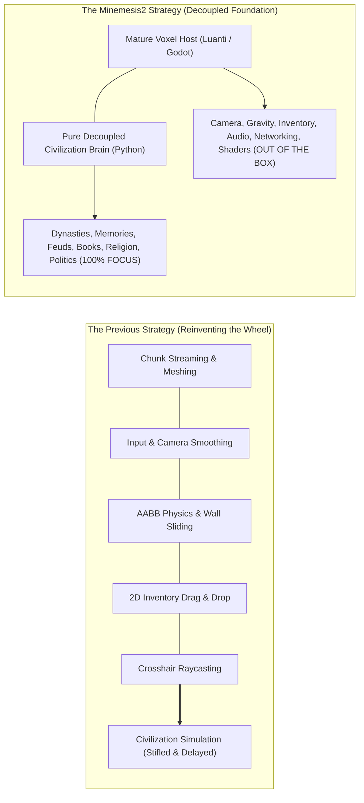
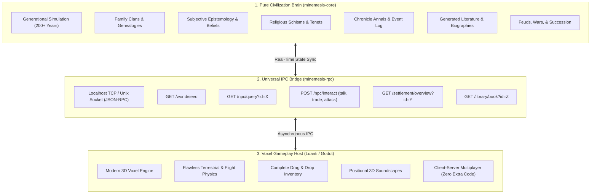
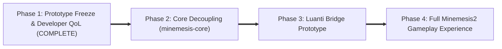

# MINEMESIS2 TECHNOLOGY REVIEW & STRATEGIC RESET BLUEPRINT

> **Directive:** *MINEMESIS2 RESET DIRECTIVE — Freeze custom voxel engine development. Reuse aggressively. Innovate only where Minemesis is unique.*  
> **Guiding Axiom:** *The unique part of Minemesis is beliefs, memories, knowledge, culture, history, families, politics, and books. The unique part is NOT mouse look, hotbars, inventory, gravity, chunk meshing, or pathfinding.*

---

## 1. Executive Diagnosis: The Voxel Engine Trap

The development of the Stage E0–E3 prototype produced two starkly divergent results:

1. **The Civilization Simulation Engine ("The Brain"):**
   - **Status:** **World-Class Innovation.**
   - Generates 200+ years of grounded history, true generational bloodlines, subjective religious schisms, personal epistemological memories, clan feuds, and dynamically transcribed historical literature.
   - Every entity in the world possesses true parentage, living spouses, feuds, and daily schedules.
   - This is the soul and proprietary IP of Minemesis.

2. **The Custom Voxel Engine ("The Body"):**
   - **Status:** **High Friction, High Maintenance Prototype.**
   - Required fighting basic camera smoothing, chunk meshing edge cases, AABB collision sliding, gravity dip offsets, inventory drag-and-drop hit testing, and soft-cone raycasting.
   - Voxel engineering has accumulated **15 years of battle-tested solutions** across projects like Minecraft, Luanti (Minetest), Veloren, Vintage Story, and Terasology.
   - Attempting to rebuild chunk streaming, audio propagation, networked physics, and inventory management in Python while simultaneously building an unprecedented civilization simulator divides focus and slows momentum.

---

## 2. Analysis of Strategic Architectural Options

We evaluated three potential strategic pathways for Minemesis2:

### Option A: Embed into an Existing Voxel Engine / Game (Game as Platform)
- **Concept:** Adopt a mature open-source voxel game (such as **Luanti / Minetest** or **Veloren**) as the host client-server runtime. Minemesis is authored as a comprehensive gamepack/mod that connects to the Python civilization simulation.
- **Pros:**
  - Zero time spent on mouse look, hotbars, inventory GUI, chunk streaming, lighting, sound, or network multiplayer.
  - Complete ecosystem of existing assets (textures, models, sound packs, shaders).
  - Can be played by thousands of users immediately on Windows, Linux, macOS, and mobile.
- **Cons:**
  - Must conform to the host engine's modding constraints and API lifecycle.
  - Lua or Rust modding sandbox requires an inter-process bridge to Python.

### Option B: Fork an Existing Open-Source Voxel Game
- **Concept:** Fork the C++ source of Minetest or the Rust source of Veloren, strip out unneeded default gameplay (e.g. fantasy mobs, arbitrary crafting recipes), and compile the Minemesis simulation engine directly into the core binary.
- **Pros:**
  - Total control over the binary, splash screen, branding, and distribution installer.
  - Native in-process performance without network/socket serialization overhead.
- **Cons:**
  - High ongoing maintenance burden when merging upstream engine improvements and security patches.
  - Compiling large C++ or Rust codebases with embedded Python runtimes (CPython / PyO3) introduces packaging friction across operating systems.

### Option C: Build on a Modern Game Engine with a Voxel Plugin (e.g., Godot 4 + godot_voxel)
- **Concept:** Build Minemesis in **Godot 4** utilizing Zylann's `godot_voxel` C++ extension. Godot handles input, camera, UI widgets, animation trees, post-processing shaders, and audio, while a custom scene drives the Minemesis gameplay loop.
- **Pros:**
  - State-of-the-art UI system (Control nodes, responsive containers, rich text BBCode for historical books).
  - First-class visual fidelity (Vulkan Forward+, volumetric fog, dynamic shadows, post-processing).
  - Seamless Python integration via GDExtension, Py4Godot, or local IPC.
- **Cons:**
  - Voxel gameplay mechanics (block break timers, player inventory grids, hotbars) must still be configured in Godot scenes, though Godot's node hierarchy makes this vastly simpler than raw OpenGL.

---

## 3. Technology Evaluation Matrix

We conducted an in-depth technical audit of the five major open-source and modular voxel platforms:

| Engine | Core Language | Scripting / API | License | Maturity | Inventory & Movement Out of Box | Simulation Integration Friction | Standalone Viability | Overall Score |
| :--- | :--- | :--- | :--- | :---: | :---: | :---: | :---: | :---: |
| **Luanti (Minetest)** | C++17 | Lua 5.1 / LuaJIT | LGPL-2.1 | **14+ Years** (Ultra-stable) | **100% Complete** | **LOW** (IPC / Sockets / SQLite) | **High** (Custom gamepack) | **9.4 / 10** |
| **Godot 4 + godot_voxel**| C++ | GDScript / C# / GDExt | MIT | **7+ Years** (Active) | **75% Complete** (Needs UI scenes) | **LOW-MEDIUM** (GDExtension / IPC) | **Maximum** (Custom standalone) | **9.0 / 10** |
| **Veloren** | Rust | Monolithic / Rust | GPL-3.0 | 6 Years (Fast-moving) | **90% Complete** | **HIGH** (Rust compile barrier) | **Moderate** (Complex fork) | **7.2 / 10** |
| **Terasology** | Java | Java (Gestalt ECS) | Apache 2.0 | 12 Years | **85% Complete** | **MEDIUM-HIGH** (JVM-Python bridge) | **Moderate** (Heavy JVM footprint)| **6.5 / 10** |
| **Vintage Story Architecture**| C# (.NET) | C# Mod API | Proprietary | 8 Years (Polished) | **100% Complete** | **DISQUALIFIED** (Cannot redistribute) | **Zero** (Requires paid game) | **N/A** |

---

## 4. Deep-Dive Subsystem Breakdown

### 4.1 Luanti (formerly Minetest) — The Pragmatic Powerhouse
- **Why it fits Minemesis:**
  - Luanti is not just a game; it is an **extensible voxel engine**. The engine itself contains zero game logic; games (like *Minetest Game*, *VoxeLibre*, *NodeCore*) are entirely separate packages written in Lua.
  - Provides instant, flawless Quake-grade movement, jump physics, collision sliding, customizable view bobbing, full 3D audio, chunk streaming, dynamic day/night lighting, and client-server multiplayer out of the box.
  - **Formspecs (UI Engine):** Enables native, scriptable 2D dialogue windows, trading interfaces, chronicle books, and inventory panels with zero OpenGL programming.
  - **Database Independence:** Worlds can be backed by SQLite3 or PostgreSQL. Minemesis can seed the world database directly from Python before the client even boots.
- **Simulation Bridge Strategy:**
  - Minemesis runs as a standalone Python background service (`minemesis-daemon`).
  - A lightweight Luanti mod (`minemesis_bridge.lua`) communicates with the Python daemon via local TCP sockets (`127.0.0.1:48123`) or HTTP/JSON-RPC.
  - When the player talks to an NPC in Luanti, the mod requests dialogue, family history, and personal beliefs from the Python daemon in 2 milliseconds, then renders a native Luanti dialogue formspec.

### 4.2 Godot 4 + godot_voxel (Zylann) — The Visual & Standalone Champion
- **Why it fits Minemesis:**
  - If standalone branding, custom stylized shaders, and bespoke first-person animations are mandatory, Godot 4 is the strongest candidate.
  - Zylann's `godot_voxel` is a production-grade C++ module providing blocky voxels, greedy meshing, LOD terrain streaming, and fast voxel raycasting.
  - Godot's UI system allows creating parchment book readers, family dynasty tree visualizers, and interactive diplomatic maps using native GUI containers.
- **Simulation Bridge Strategy:**
  - Python civilization simulation runs either as a linked GDExtension library or via an asynchronous IPC socket.

### 4.3 Veloren — The Rust Contender
- **Why it is secondary:**
  - Veloren has stunning graphics and an advanced procedural world generation system.
  - However, Veloren's codebase is written in modern Rust with a custom ECS. Merging a dynamic, stateful Python generational simulation into Veloren's compile-time borrow-checker model requires significant Rust FFI glue and rebuilding Veloren from source on every update.
  - It is an incredible technological achievement, but the development friction is disproportionately high for a pair-programming project centered on historical simulation.

### 4.4 Vintage Story — Architectural Lessons
- While legally disqualified for standalone open distribution, Vintage Story proves the value of **micro-interactions**:
  - NPC daily schedules should feel grounded in work stations (anvils, hearths, fields).
  - Books and scrolls should be physical objects stored in libraries and private chests.
  - Construction should have societal consequence (settlement walls raise defensibility metrics).

---

## 5. The Minemesis2 Decoupled Architecture

Minemesis2 strictly enforces a **three-tier decoupled architecture**:

### The Inviolable Separation of Responsibilities

| Responsibility | Handled By | Implementation |
| :--- | :--- | :--- |
| **History & Time Advancement** | `minemesis-core` (Python) | Generational simulation ticks, marriages, births, succession, feuds. |
| **Beliefs & Memories** | `minemesis-core` (Python) | Subjective belief graph; NPC knowledge diffusion; gossip. |
| **Literature Generation** | `minemesis-core` (Python) | Mark-down / text book synthesis; poetry; chronicles. |
| **Voxel World Rendering** | Voxel Host (Luanti / Godot) | Chunk meshing, greedy meshing, shaders, skybox, ambient occlusion. |
| **Player Movement & Camera** | Voxel Host (Luanti / Godot) | Mouse look, WASD, jump, sprint, fly mode, collision sliding. |
| **Inventory & Hotbar** | Voxel Host (Luanti / Godot) | Item dragging, stack splitting, slot tooltips, crafting grids. |
| **Sound & Particles** | Voxel Host (Luanti / Godot) | Footstep audio, block mining cracks, debris particles, ambient wind. |

---

## 6. Concrete Phased Migration Roadmap

### Phase 1: Prototype Freeze & Developer QoL (Completed)
- **Status:** **DONE.**
- Current custom engine prototype frozen on branch `big-build` (tag `playability-complete`).
- Immediate developer debug tools implemented and verified:
  - **`[F8]` 3D Fly Mode:** Spectator flight in look direction, 42 m/s fast travel sprint, Space/Ctrl vertical lift.
  - **`[F9]` Creative Build Mode:** Infinite building blocks, instant 1-click block mining with zero hardness delay.
  - **Overhead NPC Debug Labels:** Floating 3D world-to-screen labels displaying Name, Clan, Profession, and Current AI Task above every citizen.

### Phase 2: Decouple `minemesis-core` into an Independent Package
- Extract the simulation engine into a clean, standalone Python library `minemesis-core` with zero Pygame, OpenGL, or GLFW dependencies.
- Ensure the package runs headlessly on any machine and exposes clean serialization (`to_dict()`, SQLite, and JSON-RPC).
- Verify 100% test coverage over generational history, book generation, and clan succession.

### Phase 3: The Luanti Minemesis2 Bridge Prototype
- Install Luanti (Minetest) and create a custom game folder: `games/minemesis/`.
- Write `minemesis_bridge` Lua mod:
  1. Boot a local Luanti world.
  2. The Lua mod launches the background `minemesis-core` daemon.
  3. The terrain generator queries the Python world spec to place settlements, houses, shrines, and town halls.
  4. Spawn embodied Luanti entities for each living citizen.
  5. Right-clicking an NPC opens a native Luanti dialog formspec showing their clan, spouse, children, subjective faith, and recent memories.

### Phase 4: Full Minemesis2 Gameplay Experience
- Enable players to explore sprawling, living historical settlements with zero engine bugs, flawless Quake movement, full audio, and seamless inventory management.
- Reconnect physical player actions to historical consequences:
  - Building a wall in Luanti increases the settlement's defense score in `minemesis-core`.
  - Attacking a chief marks the player as an outlaw in the simulation event log.
  - Books written by ancient scribes can be picked up, read, and stored in town bookshelves.

---

## 7. Strategic Conclusion

> **The hard part of Minemesis was always the civilization simulator — and it already works.**  
>
> Re-engineering camera smoothing, inventory hit-testing, and chunk meshing from scratch was a detour. By adopting **Luanti (Minetest)** as the primary gameplay host and keeping **Godot 4** as an alternative visual engine, Minemesis2 immediately inherits 15 years of polished voxel gameplay.  
>
> All development energy can now be focused 100% on what makes Minemesis unique: **a living, breathing, historical human world.**
