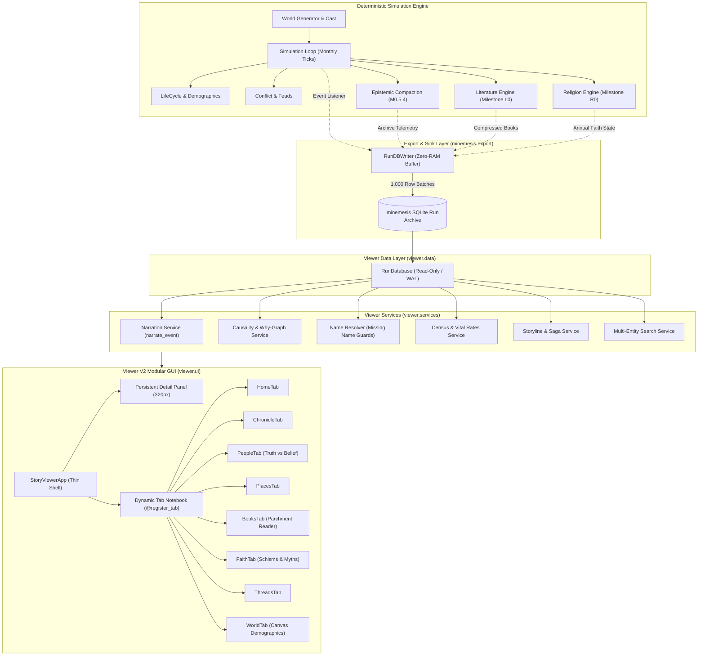

# Minemesis Architecture Dossier (Viewer V2 & Core Engine)

## Executive Summary
Minemesis simulates centuries of emergent human civilization, interpersonal relationships, subjective beliefs, oral traditions, and religious evolution. To ensure constant memory overhead and seamless inspection, **Viewer V2** decouples historical execution from visualization using a relational streaming database architecture (`.minemesis`).

---

## Architectural Layers

### 1. Simulation & Core Engine (`minemesis/`)
- **Single Source of Truth**: The immutable `EventLog` records objective facts.
- **Epistemic Isolation**: Characters form subjective beliefs and memories based strictly on perception and gossip.
- **Name Integrity**: Every character receives a permanent first name, surname, and sequential ordinal ("II", "III") at creation. Invented placeholder tokens (e.g. "Master Thorne") are strictly prohibited.
- **Epistemic Compaction**: Historical dead characters (> 20 simulated years) have individual memory dictionaries reclaimed, while biographical identity is retained in `historical_archive`.

### 2. Zero-RAM Streaming Exporter (`minemesis/export/`)
- `RunDBWriter` implements `RunDBSink`. It buffers incoming events, census metrics, and archived citizens into memory chunks of 1,000 rows.
- Each chunk is written in a single SQLite transaction and immediately purged from RAM, allowing multi-century simulations to run with flat memory consumption.
- Book pages are zlib-compressed upon authoring and cleared from the simulation heap.
- At run completion, an automated **Name Integrity Audit** query executes, guaranteeing zero unresolved or dangling participants.

### 3. Run Database Archive (`.minemesis`)
- Standard SQLite database with WAL journal mode.
- 14 normalized, indexed tables:
  `meta`, `settlements`, `census`, `events`, `event_participants`, `event_causes`, `characters`, `epistemic_ledger`, `books`, `religions`, `holy_sites`, `myths`, `threads`, `name_audit`.

### 4. Data Access Layer (`viewer/data/`)
- `RunDatabase` opens the archive in read-only mode (`mode=ro`).
- Enforces forward-compatible schema version verification against `meta.schema_version`.
- Provides virtualized, paginated queries with `LIMIT`/`OFFSET` so the UI thread remains sub-16ms responsive.

### 5. Services Layer (`viewer/services/`)
- `NameResolver`: Resolves display names, highlighting any missing entities with a visible red `[? ID]` indicator.
- `NarrationService`: Pluggable sentence generator converting raw events to human-readable prose, with fallback to JSON for novel event types.
- `CausalityService`: Traverses forward consequences and ancestral causal chains backwards.
- `CensusService`: Aggregates population curves, vital rates, and economic resource trajectories.

### 6. User Interface Layer (`viewer/ui/`)
- **Thin Shell (`app.py`)**: Hosts menu actions, navigation history (Back/Forward), and theme toggling.
- **Tab Registry (`@register_tab`)**: Decouples tabs from the main window. New tabs register dynamically without modifying `app.py`.
- **Persistent Detail Panel**: 320px right-hand pane that displays selected entities immediately upon clicking anywhere in the application.
- **Native Canvas Charts**: Zero external dependencies (no matplotlib or numpy) ensuring instant executable launch times and small bundle sizes.
