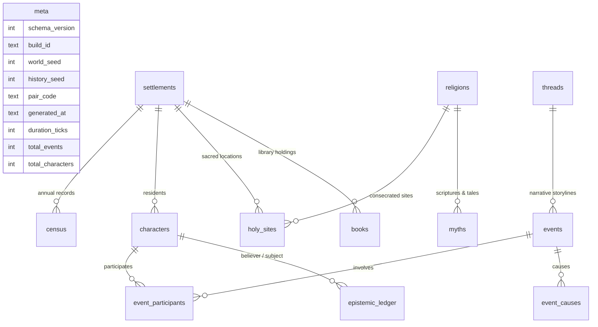

# Minemesis Run Database Schema (.minemesis)

**Schema Version:** 1  
**Build Target:** `viewer-v2`  
**Storage Engine:** SQLite 3 (WAL Mode, `query_only=ON`)

The `.minemesis` file format is a single-file, relational database containing the complete, objective historical record and subjective epistemic state of a Minemesis simulation run.

---

## Entity Relationship Overview



---

## Detailed Table Specifications

### 1. `meta`
Global metadata and provenance for the run. Contains exactly one row.
| Column | Type | Constraints | Description |
|---|---|---|---|
| `schema_version` | INTEGER | NOT NULL | Incremental schema version (current: 1). |
| `build_id` | TEXT | NOT NULL | Version identifier (`viewer-v2`). |
| `world_seed` | INTEGER | NOT NULL | RNG seed governing geography and starting cast. |
| `history_seed` | INTEGER | NOT NULL | RNG seed governing events and social causality. |
| `pair_code` | TEXT | NOT NULL | Human-readable pair code (e.g. `42:1337`). |
| `generated_at` | TEXT | NOT NULL | ISO 8601 UTC timestamp of export completion. |
| `duration_ticks` | INTEGER | NOT NULL | Total elapsed simulation ticks (12 ticks = 1 year). |
| `total_events` | INTEGER | NOT NULL | Total recorded events in the run. |
| `total_characters` | INTEGER | NOT NULL | Total citizens born or generated. |

---

### 2. `settlements`
Geographical and cultural profiles of settlements.
| Column | Type | Constraints | Description |
|---|---|---|---|
| `id` | TEXT | PRIMARY KEY | Unique identifier (`set_oakhaven`). |
| `name` | TEXT | NOT NULL | Canonical cultural place name (`Oakhaven`). |
| `founded_tick` | INTEGER | NOT NULL | Simulation tick when settlement was founded. |
| `biome` | TEXT | NOT NULL | Dominant biome profile (`Temperate Forest`). |
| `culture` | TEXT | NOT NULL | Cultural tradition (`anglo_celtic`, `nordic`, etc.). |

---

### 3. `census`
Annual demographic and economic time series per settlement.
| Column | Type | Constraints | Description |
|---|---|---|---|
| `year` | INTEGER | NOT NULL | Simulated calendar year. |
| `settlement_id` | TEXT | NOT NULL | Foreign key to `settlements.id`. |
| `population` | INTEGER | NOT NULL | Living population count at year end. |
| `food` | REAL | NOT NULL | Remaining grain/meat food stores. |
| `wealth` | REAL | NOT NULL | Accumulated settlement economic capital. |
- **Indexes:** `idx_census_year` on `(year)`, `idx_census_settlement` on `(settlement_id)`.

---

### 4. `events`
Chronological, immutable objective history log.
| Column | Type | Constraints | Description |
|---|---|---|---|
| `event_id` | INTEGER | PRIMARY KEY | Monotonic unique event sequence number. |
| `tick` | INTEGER | NOT NULL | Simulation tick when event transpired. |
| `year` | INTEGER | NOT NULL | Simulated year `(tick // 12) + 1`. |
| `type` | TEXT | NOT NULL | Event classification (`Birth`, `Death`, `Feud`, `Raid`, etc.). |
| `description` | TEXT | NOT NULL | Rendered objective English description. |
| `thread_id` | TEXT | NULLABLE | Associated storyline thread (`thread_feuds`, etc.). |
| `importance` | REAL | NOT NULL DEFAULT 1.0 | Significance weight (>= 2.0 = Major Event). |
- **Indexes:** `idx_events_year`, `idx_events_type`, `idx_events_thread`.

---

### 5. `event_participants`
Normalized participant relationships with historical name snapshots.
| Column | Type | Constraints | Description |
|---|---|---|---|
| `event_id` | INTEGER | NOT NULL | Foreign key to `events.event_id`. |
| `character_id` | TEXT | NOT NULL | Unique entity ID (`char_42`, `set_ironpeak`). |
| `role` | TEXT | NOT NULL | Participant role (`actor`, `victim`, `child`, `mother`). |
| `name_at_time` | TEXT | NOT NULL | Baked display name of the participant at write-time. |
- **Indexes:** `idx_ep_event`, `idx_ep_char`.

---

### 6. `event_causes`
Direct causal Directed Acyclic Graph (DAG) edges between events.
| Column | Type | Constraints | Description |
|---|---|---|---|
| `event_id` | INTEGER | NOT NULL | The event caused by a prior action. |
| `cause_id` | INTEGER | NOT NULL | The antecedent event that triggered this event. |
- **Indexes:** `idx_ec_event`, `idx_ec_cause`.

---

### 7. `characters`
Biographical identity and family genealogy.
| Column | Type | Constraints | Description |
|---|---|---|---|
| `id` | TEXT | PRIMARY KEY | Unique sequence ID (`char_102`). |
| `first_name` | TEXT | NOT NULL | Pure given name (`Kaelen`). |
| `last_name` | TEXT | NOT NULL | Pure family surname (`Stone`). |
| `display_name` | TEXT | NOT NULL | Resolved display name with ordinals (`Kaelen Stone II`). |
| `name_ordinal` | INTEGER | NOT NULL DEFAULT 1 | Sequential ordinal (1 = I, 2 = II, 3 = III). |
| `birth_tick` | INTEGER | NOT NULL | Tick born or generated. |
| `death_tick` | INTEGER | NULLABLE | Tick of death (NULL if alive). |
| `sex` | TEXT | NOT NULL | Biological sex (`M` or `F`). |
| `settlement_id` | TEXT | NOT NULL | Residence settlement ID. |
| `mother_id` | TEXT | NULLABLE | Mother's character ID. |
| `father_id` | TEXT | NULLABLE | Father's character ID. |
| `spouse_id` | TEXT | NULLABLE | Current living spouse ID. |
| `cause_of_death` | TEXT | NULLABLE | Recorded cause of demise (`Accident`, `Old Age`, `Slain in feud`). |
| `profession` | TEXT | NOT NULL DEFAULT 'Laborer' | Primary occupation. |
| `is_historical` | INTEGER | NOT NULL DEFAULT 0 | Flag indicating Tier 2 compaction archive. |
- **Indexes:** `idx_char_settlement`, `idx_char_display_name`.

---

### 8. `epistemic_ledger`
Objective reality versus subjective human beliefs (Feuds, Revelations, Retributions).
| Column | Type | Constraints | Description |
|---|---|---|---|
| `case_id` | TEXT | NOT NULL | Case identifier (`feud_84`, `revelation_120`). |
| `case_type` | TEXT | NOT NULL | Epistemic case category (`Feud`, `Revelation`, `Revenge Killing`). |
| `year` | INTEGER | NOT NULL | Simulated year. |
| `subject_character_id` | TEXT | NOT NULL | Subject of accusation or revelation. |
| `ground_truth` | TEXT | NOT NULL | Objective reality of what actually occurred. |
| `believer_character_id` | TEXT | NOT NULL | Character harboring the belief. |
| `belief_summary` | TEXT | NOT NULL | Subjective interpretation believed by the citizen. |
| `source_type` | TEXT | NOT NULL | Information channel (`DIRECT_OBSERVATION`, `GOSSIP`, `WRONGFUL_ASSUMPTION`). |
| `confidence` | REAL | NOT NULL | Subjective certainty in [0.0, 1.0]. |
- **Indexes:** `idx_ledger_case`, `idx_ledger_year`, `idx_ledger_subject`, `idx_ledger_believer`.

---

### 9. `books`
Procedural literature, annals, journals, and treaties.
| Column | Type | Constraints | Description |
|---|---|---|---|
| `id` | TEXT | PRIMARY KEY | Unique manuscript ID (`book_12`). |
| `title` | TEXT | NOT NULL | Title of the work. |
| `author_id` | TEXT | NOT NULL | Character ID of the author. |
| `author_name` | TEXT | NOT NULL | Display name of the author. |
| `year_written` | INTEGER | NOT NULL | Year the manuscript was completed. |
| `settlement_id` | TEXT | NOT NULL | Library archive housing the book. |
| `topic` | TEXT | NOT NULL | Genre / Subject (`History`, `Biography`, `Scripture`, `Journal`). |
| `pages_blob_compressed` | BLOB | NOT NULL | zlib-compressed JSON array of page text strings. |
| `page_count` | INTEGER | NOT NULL | Total number of paginated pages. |
- **Indexes:** `idx_books_settlement`, `idx_books_author`, `idx_books_year`.

---

### 10. `religions`
Theological faiths, doctrines, and heresies.
| Column | Type | Constraints | Description |
|---|---|---|---|
| `id` | TEXT | PRIMARY KEY | Unique tradition ID (`rel_0`). |
| `name` | TEXT | NOT NULL | Sacred theological name. |
| `parent_id` | TEXT | NULLABLE | Parent tradition if formed via schism or reform. |
| `founded_year` | INTEGER | NOT NULL | Year tradition emerged. |
| `founder_id` | TEXT | NULLABLE | Prophet or theologian ID. |
| `traits_json` | TEXT | NOT NULL DEFAULT '{}' | JSON dictionary of theological traits and virtues. |
| `adherent_count` | INTEGER | NOT NULL DEFAULT 0 | Count of active living adherents. |

---

### 11. `holy_sites`
Consecrated geographic locations.
| Column | Type | Constraints | Description |
|---|---|---|---|
| `settlement_id` | TEXT | NOT NULL | Settlement location ID. |
| `religion_id` | TEXT | NOT NULL | Consecrated tradition ID. |
| `dedication_year` | INTEGER | NOT NULL | Year site was dedicated. |
- **Primary Key:** `(settlement_id, religion_id)`.
- **Indexes:** `idx_hs_settlement`, `idx_hs_religion`.

---

### 12. `myths`
Sacred stories, creation legends, and oral traditions.
| Column | Type | Constraints | Description |
|---|---|---|---|
| `id` | TEXT | PRIMARY KEY | Unique myth ID (`myth_rel_0_1`). |
| `religion_id` | TEXT | NOT NULL | Associated religious tradition. |
| `title` | TEXT | NOT NULL | Title of the myth. |
| `text` | TEXT | NOT NULL | Sacred text prose. |
| `year_recorded` | INTEGER | NOT NULL | Year recorded in scriptures. |
- **Indexes:** `idx_myths_religion`.

---

### 13. `threads`
Narrative storylines aggregating related event sequences.
| Column | Type | Constraints | Description |
|---|---|---|---|
| `id` | TEXT | PRIMARY KEY | Thread identifier (`thread_feuds`). |
| `title` | TEXT | NOT NULL | Narrative storyline title. |
| `category` | TEXT | NOT NULL | Category (`Feuds`, `Faith`, `Trade`, `Lore`). |
| `start_year` | INTEGER | NOT NULL | First recorded event year. |
| `end_year` | INTEGER | NOT NULL | Most recent event year. |
| `event_count` | INTEGER | NOT NULL | Number of events in thread. |

---

### 14. `name_audit`
Automated Name Integrity Gate validation results.
| Column | Type | Constraints | Description |
|---|---|---|---|
| `character_id` | TEXT | NULLABLE | Offending entity ID. |
| `issue_type` | TEXT | NOT NULL | Issue class (`missing_name`, `dangling_participant`). |
| `details` | TEXT | NOT NULL | Description of the anomaly. |

---

## Sample SQL Queries

### 1. Retrieve Recent Major Events with Participant Display Names
```sql
SELECT e.year, e.type, e.description, ep.role, ep.name_at_time
FROM events e
JOIN event_participants ep ON e.event_id = ep.event_id
WHERE e.importance >= 2.0
ORDER BY e.event_id DESC
LIMIT 20;
```

### 2. Walk Ancestral Causal Chain for an Event
```sql
WITH RECURSIVE CausalChain(event_id, cause_id, depth) AS (
    SELECT event_id, cause_id, 1
    FROM event_causes
    WHERE event_id = 142
    UNION ALL
    SELECT ec.event_id, ec.cause_id, cc.depth + 1
    FROM event_causes ec
    JOIN CausalChain cc ON ec.event_id = cc.cause_id
    WHERE cc.depth < 6
)
SELECT e.event_id, e.year, e.type, e.description, cc.depth
FROM CausalChain cc
JOIN events e ON cc.cause_id = e.event_id
ORDER BY cc.depth DESC;
```

### 3. Check Name Integrity Gate
```sql
SELECT COUNT(*) AS total_integrity_issues FROM name_audit;
```
